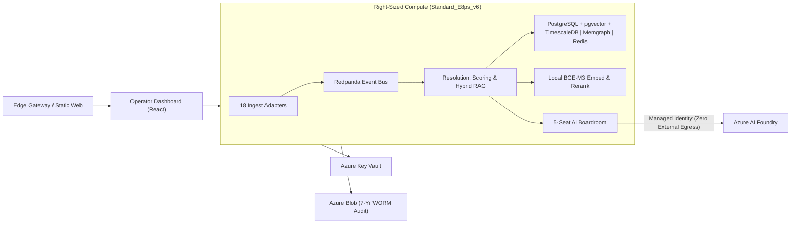

# Project Delta — Institutional AI Market Intelligence at <$1k/mo Cloud Cost

**Project Delta** is an institutional-grade, multi-agent market intelligence and decision-support platform. By combining **18 automated data feeds**, **hybrid vector/graph retrieval**, and a **5-seat AI Boardroom** (*Quant, Lawyer, Skeptic, Historian, Judge*), it delivers audited, cross-examined alerts in **~3.5 minutes median (2.4 min fastest)**—turning hours of manual analyst diligence into automated multi-agent conviction while operating at **>99% lower cloud cost** than comparable enterprise AI stacks.

-FFA62B?style=flat-square)

**[Launch Live Interactive Demo](https://damilarondo.github.io/miniature-azure-showcase/)** · **[Request Investor Walkthrough](mailto:dam.ladipo@gmail.com)**

| Live Production Desk | 38-Service Pipeline Topology |
|---|---|
|  |  |

> **Investor & Partner Notice:** This public repository is a **non-replicable architectural showcase and synthetic-data UI demo**. **The complete production platform and proprietary codebase reside in a separate private repository** (screenshots above are from the live deployed environment). Core scoring engines, prompt IP, ingestion adapters, SQL schemas, and IaC templates are intentionally excluded. See [LICENSE](LICENSE) and [AGENTS.md](AGENTS.md).

---

## Why Project Delta Wins

### 1. ~3.5-Minute Time-to-Alert With Full 5-Seat Diligence
Most AI market tools either trade depth for speed (single-LLM hallucinations) or take hours of manual analyst review. Across **41 logged multi-agent sessions**, Project Delta's **5-Seat AI Boardroom** (**Quant, Lawyer, Skeptic, Historian, and Judge**) completed full triage, hybrid RAG retrieval, adversarial cross-examination, and grounding repair in **144.9 s (2.4 min) minimum** and **212.2 s (3.5 min) median** (`420 s` session deadline)—delivering audited, multi-perspective alerts at machine speed.

### 2. Capital-Efficient Unit Economics (>$100k/mo Saved)
Traditional enterprise cloud architectures burn six figures a month before product-market fit. Project Delta's re-architected Azure topology delivers **all 38 microservices and 18 ingest adapters for under $1,000/month**, protecting gross margins and extending runway without sacrificing institutional security.

| Metric | Legacy Enterprise Estate | Project Delta Re-Architecture |
|---|---:|---:|
| **Monthly Cloud Burn** | **~$101,000–$106,000/mo** | **<$1,000/mo (>99% reduction)** |
| **Core Capabilities** | 38 services, 18 ingest adapters | **100% preserved** |
| **Security & Audit** | HSM, Geo-DR, WAF | **Zero external LLM egress, RLS, 7-yr WORM audit** |

*Detailed financial and architectural breakdown:* [docs/COST-REARCHITECTURE.md](docs/COST-REARCHITECTURE.md)

### 3. Enterprise-Ready Compliance & Data Moat
- **Zero External LLM Egress:** All model inference stays inside Azure AI Foundry under Managed Identity, paired with local in-container BGE-M3 embeddings and reranking.
- **Auditability by Design:** Every decision and authentication event is backed by **7-year immutable WORM storage** and **PostgreSQL Row-Level Security (RLS)** with point-in-time enforcement.
- **Cost & Latency Guardrails:** Automated daily token-budget caps, `420 s` hard session deadlines, and Prometheus stage-level latency histograms.

---

## Platform Architecture

Additional Production Screenshot: Real-Time Alerts & Filtering

---

## Contact & Investor Briefings

For investor decks, licensing, strategic partnerships, or a live walkthrough of the private production system:

- **Email:** [dam.ladipo@gmail.com](mailto:dam.ladipo@gmail.com)
- **LinkedIn:** [linkedin.com/in/oluwadamilare-ladipo](https://www.linkedin.com/in/oluwadamilare-ladipo)

---

## Repository Contents

| Path | Purpose |
|---|---|
| [demo/](demo/) | Interactive synthetic-data React dashboard ([Live Demo](https://damilarondo.github.io/miniature-azure-showcase/)) |
| [docs/ARCHITECTURE.md](docs/ARCHITECTURE.md) | 5-seat Boardroom design, hybrid retrieval, and reliability guarantees |
| [docs/COST-REARCHITECTURE.md](docs/COST-REARCHITECTURE.md) | Unit-economics breakdown (~$101–106k/mo → <$1k/mo) |
| [docs/images/](docs/images/) | Production dashboard screenshots (`desk.png`, `health-map.png`, `alerts.png`) |
| [preview/observability/](preview/observability/) | Non-core latency histogram & token-budget utilities |
| [preview/ui/](preview/ui/) | Non-runnable UI primitive & view previews |
| [SECURITY.md](SECURITY.md) | Security posture & disclosure policy |
| [LICENSE](LICENSE) | Proprietary All-Rights-Reserved license |
