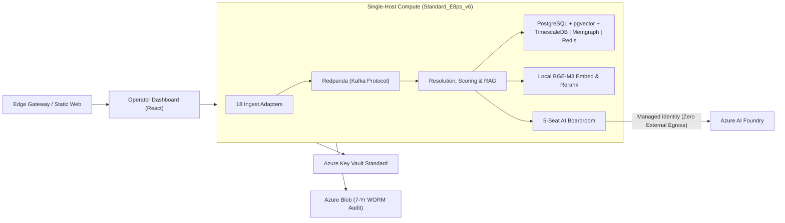
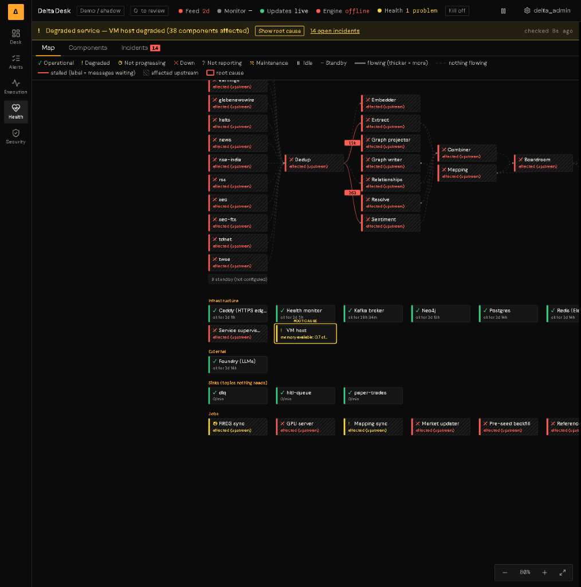

# Project Delta — Miniature Azure Re-Architecture (Showcase)

> **Notice — Showcase & Demo Only:** This public repository is a **demo and architectural showcase** for investors, partners, and clients. **The real, complete production system and full private codebase exist in a separate private repository** (with live screenshots from the deployed environment shown below). Core application logic, ingestion adapters, scoring engines, prompt templates, database schemas, and Infrastructure-as-Code (Bicep) templates are intentionally omitted here to protect intellectual property. Live walkthroughs of the production system are available upon request. See [LICENSE](LICENSE) and [AGENTS.md](AGENTS.md).

---

## Executive Overview

**Project Delta** is a multi-agent market intelligence and decision-support platform powered by a **5-seat AI Boardroom**, 18 automated ingest adapters, hybrid vector/graph/time-series retrieval, and real-time alerting.

This showcase documents the **Miniature Azure Re-Architecture**: a ground-up infrastructure redesign that reduced projected Azure cloud spend by **over 99%—from ~$101,000–$106,000/month down to under $1,000/month**—while preserving all ~38 microservices, all 18 ingest adapters, row-level security, 7-year WORM audit retention, and zero external LLM egress.

### Key Highlights

| Pillar | Outcome |
|---|---|
| **Multi-Agent AI Boardroom** | 5 specialized AI seats (*Quant, Lawyer, Skeptic, Historian, Judge*) deliberating across structured rounds with dynamic fallback routing |
| **>99% Cloud Cost Reduction** | Consolidated an over-provisioned multi-region AKS + Managed PaaS estate (~$101–106k/mo) into a single-host `Standard_E8ps_v6` topology + serverless event jobs (<$1k/mo) |
| **Zero-Egress Security** | All LLM inference routed strictly through Azure AI Foundry via Managed Identity, plus local in-container BGE-M3 embedding & reranking |
| **Enterprise Compliance** | PostgreSQL Row-Level Security (RLS), Azure Key Vault Standard, and 7-year immutable WORM audit storage |
| **Observability & Cost Controls** | Sub-budget latency histograms (RAG, Round 1, Round 2, Judge) and automated daily token-budget caps |

---

## High-Level System Architecture



---

## Operator Dashboard Showcase

### Live Screenshots

| Desk View | Pipeline Health Topology | Alerts & Filtering |
|---|---|---|
|  |  |  |

### Interactive Mock-Data Demo (`demo/`)

A sanitized, **100% synthetic-data** interactive build of the dashboard is included in [demo/](demo/) so partners and evaluators can explore the UI locally or deploy it as a static site—without any backend APIs, execution venue guides, or proprietary logic:

```bash
cd demo
npm install
npm run dev
```

---

## What Is Included in This Showcase

| Path | Description |
|---|---|
| [demo/](demo/) | Buildable, synthetic-data React/Vite interactive dashboard demo |
| [docs/ARCHITECTURE.md](docs/ARCHITECTURE.md) | System topology, 5-seat AI Boardroom design, hybrid retrieval, and reliability guarantees |
| [docs/COST-REARCHITECTURE.md](docs/COST-REARCHITECTURE.md) | Breakdown of the ~$101–106k/mo → sub-$1k/mo Azure cost optimization |
| [docs/images/](docs/images/) | Sanitized dashboard screenshots (`desk.png`, `health-map.png`, `alerts.png`) |
| [preview/observability/](preview/observability/) | Sanitized non-core telemetry, Prometheus latency histograms, and daily token-budget utilities |
| [preview/ui/](preview/ui/) | Non-runnable React UI primitives and view previews (`Desk`, `Health`, `Alerts`, `Security`) |
| [SECURITY.md](SECURITY.md) | Security architecture posture and disclosure policy |
| [LICENSE](LICENSE) | Proprietary All-Rights-Reserved license |

*Omitted by design:* Core pipeline microservices, proprietary prompts, scoring/risk engines, SQL migrations, `.env` configurations, Dockerfiles, and Azure Bicep IaC templates.
