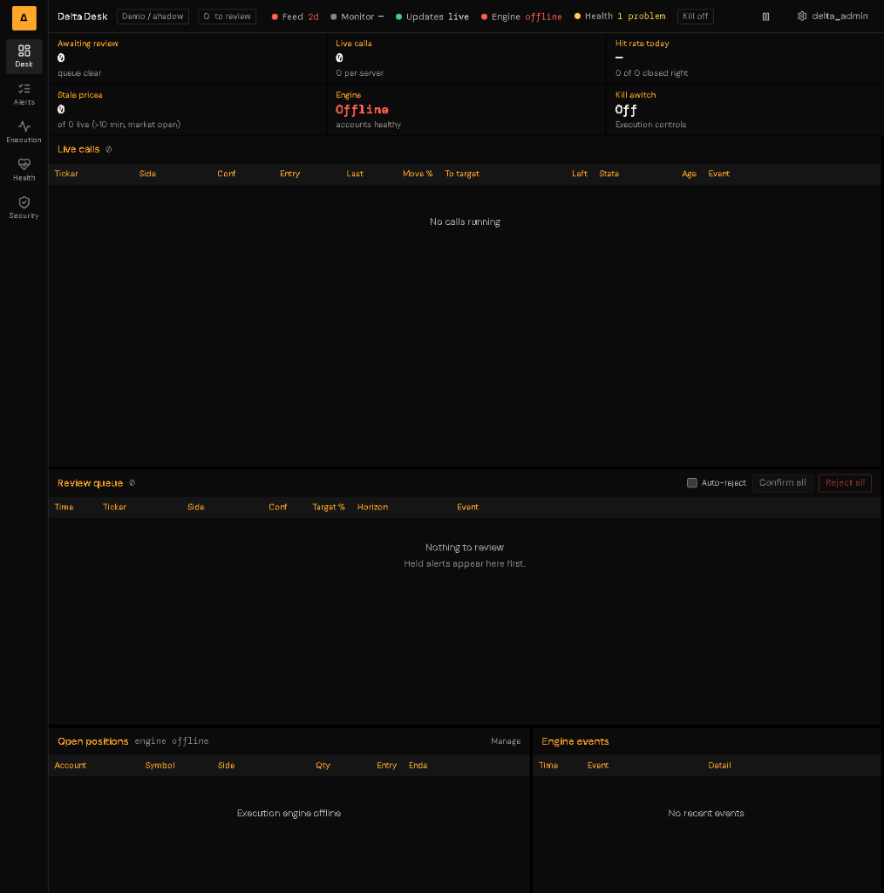
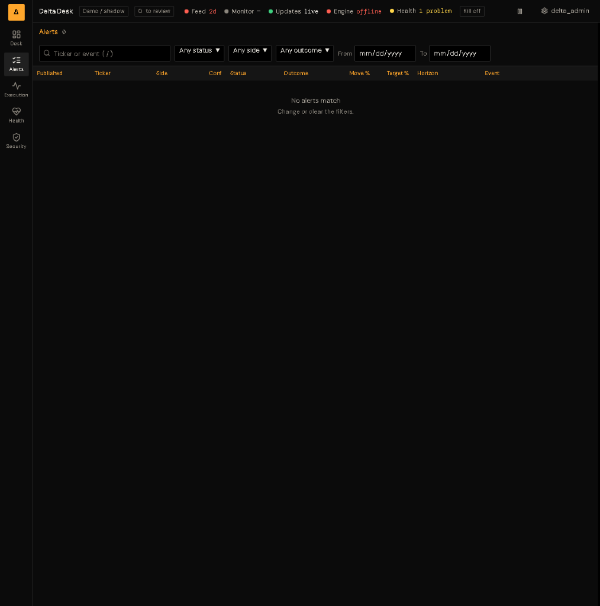
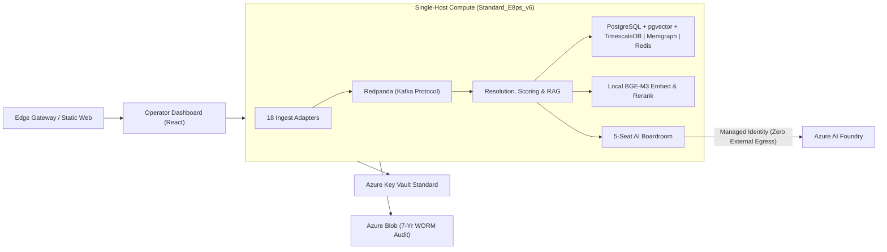

# Project Delta — $105k/mo → <$1k/mo Azure AI Re-Architecture

**How we cut a 38-service Azure AI & market-intelligence platform by >99% (~$101k–$106k/mo down to <$1k/mo) while preserving all 18 ingest adapters, a 5-seat AI Boardroom, row-level security, and zero external LLM egress.**


| Live Production Desk | 38-Service Pipeline Topology |
|---|---|
|  |  |

> **Showcase & Demo Only:** This public repository is a **demo and architectural showcase** for investors, partners, and clients. **The real, complete production system and full private codebase exist in a separate private repository** (screenshots above are from the live deployed environment). Core application logic, ingestion adapters, scoring engines, prompt templates, SQL schemas, and Bicep IaC templates are intentionally omitted to protect intellectual property. See [LICENSE](LICENSE) and [AGENTS.md](AGENTS.md).

---

## Interactive Demo (100% Synthetic Data)

**[Launch Live Interactive Demo](https://damilarondo.github.io/miniature-azure-showcase/)** — deployed from [`demo/`](demo/) with 100% synthetic data.

Run locally in 30 seconds:

```bash
cd demo
npm install
npm run dev
```

<details>
<summary>Additional Screenshot: Alerts & Filtering View</summary>



</details>

---

## The >99% Azure Cost Re-Architecture

The legacy enterprise Bicep estate provisioned multi-region, high-availability PaaS services (~$101k–$106k/mo) for a workload whose 38-service stack already runs cleanly on a single machine.

| Architecture | Monthly Azure Spend | Key Components |
|---|---:|---|
| **Legacy Enterprise Estate** | **~$101,000–$106,000/mo** | Event Hubs Dedicated (~$65k), 3× PG Flexible HA (~$12k), Managed Redis X150 (~$9k), 4× AKS Pools (~$6k), Memgraph HA (~$3k), Firewall/WAF/AppGW (~$3k), Geo-DR & HSM (~$3k) |
| **Re-Architected Stack** | **<$1,000/mo** | Single `Standard_E8ps_v6` compose host + Azure AI Foundry + ACR Basic ($5.07) + Key Vault Standard (~$1) + Static Web Apps ($0) + 4× Consumption Jobs (~$2) + 7-Yr WORM Blob (~$7.50) |

*Full breakdown and why serverless-per-service (~$592/mo) was rejected:* [docs/COST-REARCHITECTURE.md](docs/COST-REARCHITECTURE.md)

---

## System Architecture



- **5-Seat AI Boardroom:** *Quant, Lawyer, Skeptic, Historian, and Judge* deliberate across structured rounds with dynamic provider/model fallback and strict p95 latency sub-budgets (`15s` total).
- **Zero External LLM Egress:** Inference routes exclusively through Azure AI Foundry via Managed Identity, paired with local in-container BGE-M3 embeddings and reranking.
- **Enterprise Compliance:** PostgreSQL Row-Level Security (RLS), fail-closed retrieval, and 7-year immutable WORM audit storage.

---

## Contact & Live Walkthroughs

For investor, partnership, licensing, or live production walkthrough inquiries:

- **Email:** [dam.ladipo@gmail.com](mailto:dam.ladipo@gmail.com)
- **LinkedIn:** [linkedin.com/in/oluwadamilare-ladipo](https://www.linkedin.com/in/oluwadamilare-ladipo)

---

## Repository Map

| Path | Description |
|---|---|
| [demo/](demo/) | Buildable, synthetic-data React/Vite interactive dashboard demo |
| [docs/ARCHITECTURE.md](docs/ARCHITECTURE.md) | 5-seat Boardroom design, hybrid retrieval, and reliability guarantees |
| [docs/COST-REARCHITECTURE.md](docs/COST-REARCHITECTURE.md) | Detailed breakdown of the ~$101–106k/mo → sub-$1k/mo optimization |
| [docs/images/](docs/images/) | Sanitized production dashboard screenshots (`desk.png`, `health-map.png`, `alerts.png`) |
| [preview/observability/](preview/observability/) | Sanitized non-core Prometheus latency histograms and token-budget utilities |
| [preview/ui/](preview/ui/) | Non-runnable React UI primitives and view previews (`Desk`, `Health`, `Alerts`, `Security`) |
| [SECURITY.md](SECURITY.md) | Security posture and private vulnerability disclosure policy |
| [LICENSE](LICENSE) | Proprietary All-Rights-Reserved license |
